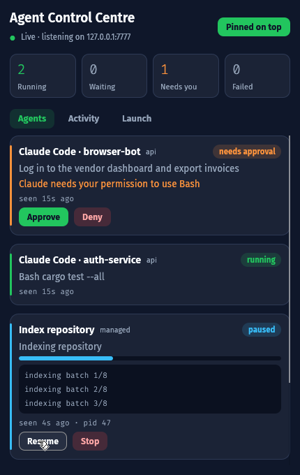

# Agent Control Centre

A **native desktop app** (Rust + egui, no browser or web view) that keeps every AI
agent on your machine visible in one small always-on-top window. See what each
agent is doing, get a native notification when one needs approval, finishes or
fails, and **launch, pause, resume and stop** agents from one place.
Runs on **Linux** and **Windows**.


| Needs approval | Managed agent, paused | Activity history |
|---|---|---|
|  |  |  |

## What it does

- **Live agent board**: status, task, progress, heartbeat age. Items needing you float to the top.
- **Approve / Deny** agent requests. The agent polls the API for your answer.
- **Native notifications** for approval-needed, finished, failed and lost agents.
- **Launch agents** from the *Launch* tab (any shell command). Output streams into the card;
  the child can report progress via `acc emit ... $ACC_AGENT_ID`.
- **Pause / Resume / Stop** managed agents and reporting agents that supply a `pid` (Linux: real
  SIGSTOP/SIGCONT on the whole process group; Windows: Stop only).
- **Auto-detect** agent CLIs already running (Claude Code, Codex, Gemini CLI, Aider, OpenCode, Goose,
  Cursor Agent, LangGraph, CrewAI) with CPU/memory, and control them too. Best-effort name matching.
- **Persistent activity log** (`history.jsonl` in your data dir) survives restarts.
- **Claude Code integration** through hooks, see below.

## Install

Grab the archive for your OS from [Releases](../../releases) and run `agent-control-centre`
(`.exe` on Windows). Put `acc` (the small CLI) on your `PATH` if you want hooks/scripts. Or build:

```sh
cargo build --release     # binaries in target/release: agent-control-centre, acc
```

## Claude Code integration

Merge `integrations/claude-code-hooks.json` into `~/.claude/settings.json` (needs `acc` on `PATH`).
Every Claude Code session then shows up in the HUD: prompts as tasks, tool calls as live activity,
permission prompts as **Approve/Deny** cards with a notification, and `Stop` as finished.
Hooks fail silently when the HUD isn't running, so they never block Claude.
(Approve/Deny in the HUD is a visual signal; Claude Code's own prompt still needs answering.)

## Event API (`127.0.0.1:7777`, local only)

```sh
acc emit agent.started my-agent --name "My Agent" --task "Refactoring auth" --progress 10
# or plain HTTP from any language:
curl -X POST localhost:7777/event -d '{"event":"agent.progress","agent_id":"my-agent","progress":40,"pid":1234,"ttl":120}'
```

| `event` | Effect |
|---|---|
| `agent.started` / `agent.progress` | running, updates task/progress/message |
| `agent.waiting` | waiting |
| `approval.required` | Approve / Deny card + notification |
| `agent.completed` / `agent.failed` | done / failed + notification |
| `agent.heartbeat` | refresh liveness (every event does) |

Optional fields: `name`, `task`, `message`, `progress` (0-100), `pid` (enables Pause/Stop),
`ttl` (seconds of silence before the agent is flagged **lost**, default 30).
Read back: `GET /agents`, `GET /agents/<id>` → `{"status": "...", "approval": null|true|false}`.

## Notes and limits

- Anything on localhost can post events, so the port is bound to `127.0.0.1` only; don't expose it.
  The API reports state; it never starts processes. Only you can, from the Launch tab.
- Detection is name-based and can miss or mislabel unusual setups.
- Not yet: tray icon, token/cost tracking, remote machines.
- The Windows build is cross-compiled; it has had less hands-on testing than Linux.

Design system: dark slate + green accent, Fira Sans / Fira Code (SIL OFL), chosen with the ui-ux-pro-max skill.
MIT licensed.
