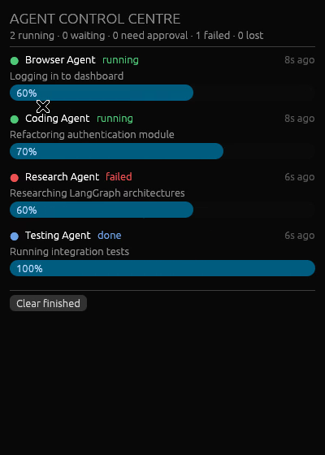

# Agent Control Centre

A small always-on-top desktop HUD (Rust + egui) that shows every AI agent running
on your machine: status, current task, progress, heartbeat age, and approval
requests. Native OS notifications fire when an agent needs approval, finishes or
fails. Works on **Linux** and **Windows**. Agents can be anything (Python, CLI,
IDE, browser automation) because they report over a plain localhost HTTP API.


| Approval needed | After you click Approve |
|---|---|
|  |  |

## Run

Download the binary from the latest CI run's artifacts (or Releases), or build:

```sh
cargo run --release
./examples/demo.sh   # in another terminal: simulates four agents
```

## Event API (`127.0.0.1:7777`, local only)

```sh
curl -X POST localhost:7777/event -d '{
  "event": "agent.started", "agent_id": "coding-01", "name": "Coding Agent",
  "task": "Refactoring auth", "progress": 10, "message": "optional text"}'
```

| `event` | Effect |
|---|---|
| `agent.started` / `agent.progress` | running, updates task/progress |
| `agent.waiting` | waiting |
| `approval.required` | HUD shows Approve / Deny, notification |
| `agent.completed` / `agent.failed` | done / failed, notification |
| `agent.heartbeat` | refresh liveness (any event does) |

Running/waiting agents silent for 30 s are flagged **lost** (+ notification).

Reading state: `GET /agents` (all) and `GET /agents/<id>` → `{"status": "...", "approval": null|true|false}`.
After sending `approval.required`, poll that endpoint until `approval` is non-null.

## Scope (v0.1)

Monitoring, notifications, approvals. Not yet: persistence/history, start/stop/pause
controls, token/cost tracking, tray icon, remote machines. The API is
agent-framework neutral, so those can be added without changing agents.
Anything on localhost can post events, so don't expose port 7777.

MIT licensed.
