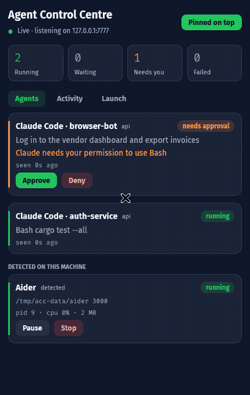
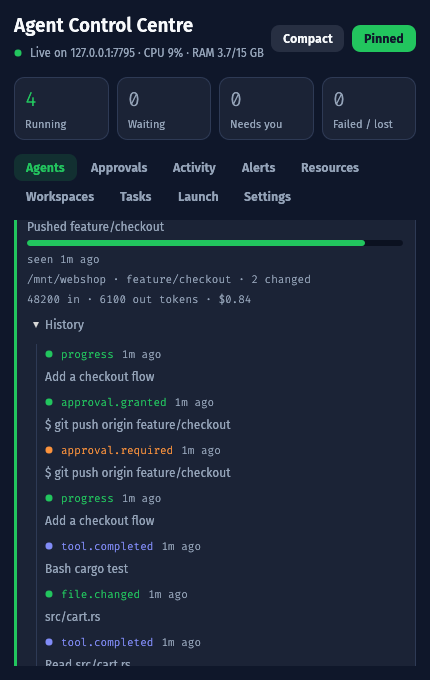
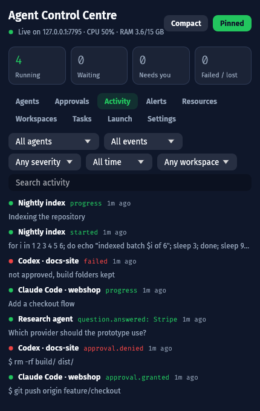

# Agent Control Centre

A **native desktop app** (Rust + egui, no browser or web view) that keeps every AI
agent on your machine visible in one small always-on-top window. See what each
agent is doing, get a native notification when one needs approval, finishes or
fails, and **launch, pause, resume and stop** agents from one place.
Runs on **Linux** and **Windows**.



| Approval with the exact action | Per-agent history | Activity feed |
|---|---|---|
|  |  |  |

## What it does

- **A harness over your coding agents.** Agents ask the HUD for permission and wait for *your* answer:
  the HUD shows the **exact command/file** and Approve / Deny, with an expiry countdown. Answers are
  bound to that one request (can't be replayed or flipped) and **an unanswered request expires, it is never
  auto-approved**. See [Answering your coding agent's prompts](#answering-your-coding-agents-prompts).
- **Activity history for every agent**, persisted across restarts: each agent card has an expandable
  History (tool calls, approvals asked / granted / denied / expired), plus a filterable Activity feed.
- **Live agent board**: status, task, progress, heartbeat age. Anything needing you floats to the top.
- **System tray + global hotkey.** The HUD lives in your tray: closing the window hides it (agents,
  notifications and approvals keep working), **Ctrl+Alt+A** shows/hides it from anywhere (change with
  `ACC_HOTKEY`, e.g. `ACC_HOTKEY=ctrl+shift+Space`), the tray menu has Show/Hide, Pin on top and Quit,
  and on Linux the tray icon turns amber with a tooltip while approvals are waiting.
- **Native notifications** for approval-needed, finished, failed and lost agents.
- **Launch agents** from the *Launch* tab (any shell command). Output streams into the card;
  the child can report progress via `acc emit ... $ACC_AGENT_ID` or gate actions with `acc ask`.
- **Pause / Resume / Stop** managed agents and reporting agents that supply a `pid` (Linux: real
  SIGSTOP/SIGCONT on the whole process group; Windows: Stop only).
- **Auto-detect** agent CLIs already running (Claude Code, Codex, Gemini CLI, Aider, OpenCode, Goose,
  Cursor Agent, LangGraph, CrewAI) with CPU/memory, and control them too. Best-effort name matching.

## Answering your coding agent's prompts

The HUD can answer a prompt only when the agent hands the decision to it. Two real integrations:

**1. Claude Code (hooks).** Merge `integrations/claude-code-hooks.json` into `~/.claude/settings.json`
(needs `acc` on `PATH`). `PreToolUse` runs `acc hook --gate mutating`: for `Bash`, `Write`, `Edit`,
`MultiEdit` and `NotebookEdit` calls the hook blocks, the HUD pops the approval, and your click is
returned to Claude Code as `allow` / `deny`. If you don't answer in time the hook returns nothing and
Claude Code shows its own normal prompt. Gate modes: `--gate off|bash|mutating|all`.
Use `integrations/claude-code-hooks-observe-only.json` to just watch. Every session, prompt and tool
call lands in the agent's history either way.

**2. Anything else (`acc ask`).** Wrap any risky step in your own agent or script:

```sh
acc ask my-agent --name "Deploy bot" --detail "kubectl delete ns staging" --timeout 120 && kubectl delete ns staging
# exit 0 = approved, 1 = denied, 2 = unanswered/expired/HUD not running (treat as NO)
```

Limits: popups that an IDE or agent draws itself (VS Code, Cursor, Codex, ...) cannot be answered from
outside unless that tool exposes a hook or API for it. The HUD never clicks other apps' windows.

## Install

Grab the archive for your OS from [Releases](../../releases) and run `agent-control-centre`
(`.exe` on Windows). Put `acc` (the small CLI) on your `PATH` if you want hooks/scripts. Or build:

```sh
cargo build --release     # binaries in target/release: agent-control-centre, acc
```

## Event API (`127.0.0.1:7777`, local only)

```sh
acc emit agent.started my-agent --name "My Agent" --task "Refactoring auth" --progress 10
# or plain HTTP from any language:
curl -X POST localhost:7777/event -d '{"event":"agent.progress","agent_id":"my-agent","progress":40,"pid":1234,"ttl":120}'
```

| `event` | Effect |
|---|---|
| `agent.started` / `agent.progress` | running, updates task/progress/message |
| `agent.waiting` | waiting |
| `approval.required` | Approval card + notification; use `approval_id` + `detail`, poll `GET /approvals/<id>` |
| `agent.completed` / `agent.failed` | done / failed + notification |
| `agent.heartbeat` | refresh liveness (every event does) |

Optional fields: `name`, `task`, `message`, `progress` (0-100), `pid` (enables Pause/Stop),
`ttl` (seconds of silence before the agent is flagged **lost**, default 30), `notify` (force a notification),
and for approvals `approval_id` (unique per request), `detail` (the exact action) and `expires_in` (seconds, default 300).
Read back: `GET /agents`, `GET /agents/<id>`, `GET /approvals` (pending) and
`GET /approvals/<id>` → `{"status": "pending|approved|denied|expired"}`. Only the HUD user can resolve an approval.

## Notes and limits

- Anything on localhost can post events, so the port is bound to `127.0.0.1` only; don't expose it.
  The API reports state; it never starts processes. Only you can, from the Launch tab.
- Tray: Linux needs a StatusNotifier host (KDE, Cinnamon, XFCE and others have one; GNOME needs the AppIndicator
  extension). If there is no tray, closing the window quits instead of hiding, and the Launch tab says so.
- Global hotkey: X11 and Windows only. On Wayland it is reported as unavailable (use the tray).
  Windows tray tooltip/icon do not change for pending approvals yet.
- Detection is name-based and can miss or mislabel unusual setups.
- Not yet: token/cost tracking, remote machines. Full list: [docs/IMPLEMENTATION_STATUS.md](docs/IMPLEMENTATION_STATUS.md).
- The local API has no auth token yet: another local process could post a fake approval *request* (it still can't answer one).
- The Windows build is cross-compiled; it has had less hands-on testing than Linux.

Design system: dark slate + green accent, Fira Sans / Fira Code (SIL OFL), chosen with the ui-ux-pro-max skill.
MIT licensed.
