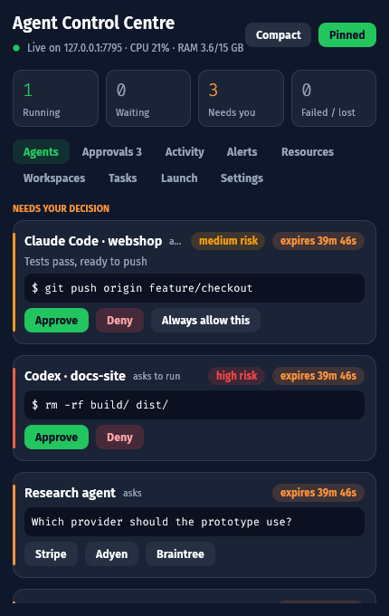
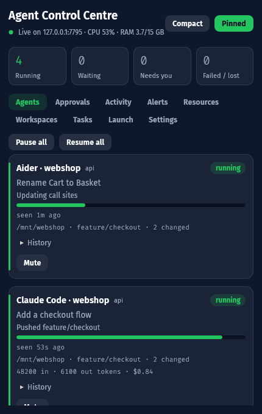
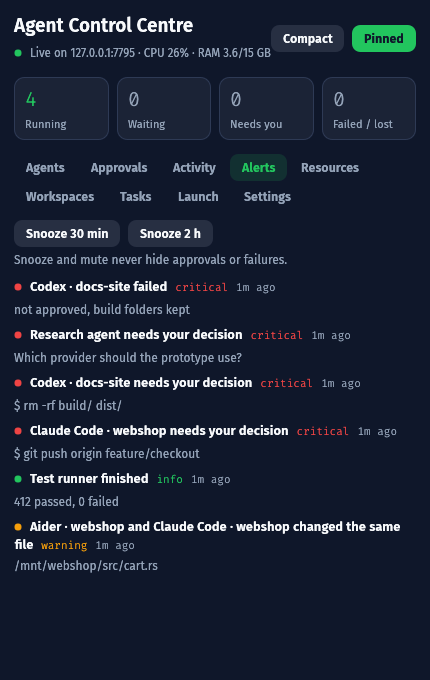
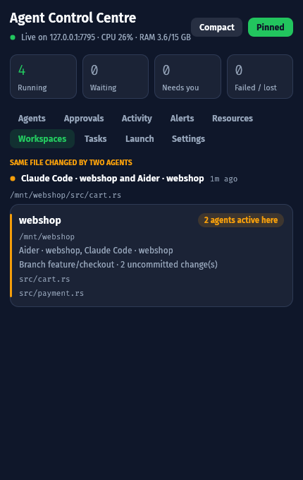
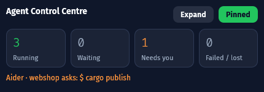
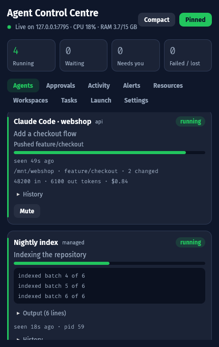

# Agent Control Centre

A **native desktop app** (Rust + egui, no browser or web view) that keeps every AI
agent on your machine visible in one small always-on-top window. See what each
agent is doing, get a native notification when one needs approval, finishes or
fails, and **launch, pause, resume and stop** agents from one place.
Runs on **Linux** and **Windows**.


| Approvals with risk level and questions | The agent board | Per-agent history |
|---|---|---|
|  |  |  |

| Activity feed with filters | Notification history | Workspaces and conflicts |
|---|---|---|
|  |  |  |

Compact mode, and an agent launched from the HUD with its output:





## What it does

- **A harness over your coding agents.** Agents ask the HUD for permission and wait for *your* answer:
  the HUD shows the **exact command/file** and Approve / Deny, with an expiry countdown. Answers are
  bound to that one request (can't be replayed or flipped) and **an unanswered request expires, it is never
  auto-approved**. See [Answering your coding agent's prompts](#answering-your-coding-agents-prompts).
- **Questions too.** An agent can offer choices (`acc ask … --options "a|b|c"`) and gets back the one you pick.
  Each request shows a **risk level**; "Always allow this" stops repeat prompts for low and medium risk
  actions, never for high risk ones.
- **Activity history for every agent**, persisted across restarts: each agent card has an expandable
  History (tool calls, approvals asked / granted / denied / expired), plus an Activity feed you can filter by
  agent, kind, severity, time, workspace and text. The agent list itself is restored after a restart, with
  anything that was mid-run marked "lost contact" until it reports again.
- **Live agent board**: status, task, progress, heartbeat age. Anything needing you floats to the top.
- **System tray + global hotkey.** The HUD lives in your tray: closing the window hides it (agents,
  notifications and approvals keep working), **Ctrl+Alt+A** shows/hides it from anywhere (change it in
  Settings or with `ACC_HOTKEY`), the tray menu has Show/Hide, Pin on top and Quit,
  and on Linux the tray icon turns amber with a tooltip while approvals are waiting.
- **Native notifications** with severity (info / warning / critical), a notification history (*Alerts* tab),
  snooze, per-agent mute and a minimum severity. Approvals and failures always get through.
- **Compact mode**: one click shrinks the window to the four counters and the request that is waiting.
- **Workspaces and resources**: which agents share a directory, its git branch and uncommitted files,
  an alert when two agents change the same file, machine CPU / RAM, and tokens and cost that agents report.
- **Launch agents** from the *Launch* tab (any shell command), or queue them (*Tasks* tab) to run a few at a
  time. Output streams into the card, with a full scrollable log, and finished agents can be restarted;
  the child can report progress via `acc emit ... $ACC_AGENT_ID` or gate actions with `acc ask`.
- **Pause / Resume / Stop** managed agents and reporting agents that supply a `pid` (Linux: real
  SIGSTOP/SIGCONT on the whole process group; Windows: Stop only). Pause shows "pausing…" until the OS
  confirms it, Stop asks for a second click, and *Pause all* / *Resume all* act on everything at once.
  Quitting the HUD (or killing it) stops the agents it launched.
- **Auto-detect** agent CLIs already running (Claude Code, Codex, Gemini CLI, Aider, OpenCode, Goose,
  Cursor Agent, LangGraph, CrewAI) with CPU/memory, and control them too. Best-effort name matching.

## Answering your coding agent's prompts

The HUD can answer a prompt only when the agent hands the decision to it. Two real integrations:

**1. Claude Code (hooks).** Run `acc install-hooks` (add `--gate off` to only watch, `--uninstall` to remove).
It merges the entries into `~/.claude/settings.json`, leaves your other hooks alone and writes a backup first.
The same entries are in `integrations/claude-code-hooks.json` if you prefer to paste them. `PreToolUse` runs `acc hook --gate mutating`: for `Bash`, `Write`, `Edit`,
`MultiEdit` and `NotebookEdit` calls the hook blocks, the HUD pops the approval, and your click is
returned to Claude Code as `allow` / `deny`. If you don't answer in time the hook returns nothing and
Claude Code shows its own normal prompt. Gate modes: `--gate off|bash|mutating|all`.
Use `integrations/claude-code-hooks-observe-only.json` to just watch. Every session, prompt and tool
call lands in the agent's history either way.

**2. Anything else (`acc ask`).** Wrap any risky step in your own agent or script:

```sh
acc ask my-agent --name "Deploy bot" --detail "kubectl delete ns staging" --timeout 120 && kubectl delete ns staging
# exit 0 = approved, 1 = denied, 2 = unanswered/expired/HUD not running (treat as NO)
```

**3. Any other agent CLI (`acc run`).** `acc run --name "Codex" -- codex` runs the command as usual and
reports it to the HUD: started, still alive, finished or failed with its exit code. No per-tool detail,
because that needs a hook from the tool itself.

Limits: popups that an IDE or agent draws itself (VS Code, Cursor, Codex, ...) cannot be answered from
outside unless that tool exposes a hook or API for it. The HUD never clicks other apps' windows.

## Install

Grab the archive for your OS from [Releases](../../releases) and run `agent-control-centre`
(`.exe` on Windows). Put `acc` (the small CLI) on your `PATH` if you want hooks/scripts. Or build:

```sh
cargo build --release     # binaries in target/release: agent-control-centre, acc
cargo test --workspace    # unit tests plus an end-to-end test with three real agent processes
packaging/build-deb.sh    # optional: dist/agent-control-centre_<version>_amd64.deb
```

## Event API (`127.0.0.1:7777`, local only)

```sh
acc emit agent.started my-agent --name "My Agent" --task "Refactoring auth" --progress 10
# or plain HTTP from any language (the token is created by the HUD, see docs/protocol.md):
curl -X POST localhost:7777/api/v1/event -H "Authorization: Bearer $(cat "$(acc token)")" \
  -d '{"event":"agent.progress","agent_id":"my-agent","progress":40,"pid":1234,"ttl":120}'
```

Full reference: [docs/protocol.md](docs/protocol.md). Adapters: [Python](examples/python_agent.py),
[Node](examples/node_agent.mjs), [Rust](core/examples/rust_agent.rs).

| `event` | Effect |
|---|---|
| `agent.started` / `agent.progress` | running, updates task/progress/message |
| `agent.waiting` | waiting |
| `approval.required` | Approval card + notification; use `approval_id` + `detail`, poll `GET /approvals/<id>` |
| `agent.completed` / `agent.failed` | done / failed + notification |
| `agent.heartbeat` | refresh liveness (every event does) |
| `tool.*`, `file.changed`, `resource.updated`, `checkpoint.created` | tool calls, file changes (conflict detection), tokens and cost, checkpoints |

Optional fields: `name`, `task`, `message`, `progress` (0-100), `pid` (enables Pause/Stop),
`ttl` (seconds of silence before the agent is flagged **lost**, default 30), `notify` (force a notification),
and for approvals `approval_id` (unique per request), `detail` (the exact action) and `expires_in` (seconds, default 300).
Optional envelope: `protocol_version` (must be 1) and `event_id` (a repeated id is ignored, so retries are safe).
Read back: `GET /agents`, `GET /agents/<id>`, `GET /approvals` (pending) and
`GET /approvals/<id>` → `{"status": "pending|approved|denied|expired"}`. Only the HUD user can resolve an approval.

## Configuration

Everything is optional. Settings you change in the *Settings* tab are written to `config.json` in the data
directory (`~/.local/share/agent-control-centre/` on Linux, `%APPDATA%\agent-control-centre\` on Windows),
next to the token, history, notification history, agent list, window state and `acc.log` (structured,
one JSON object per line). A broken `config.json` falls back to defaults and the HUD says why.

| Key | Default | Meaning |
|---|---|---|
| `addr` | `127.0.0.1:7777` | Listen address. Loopback only; anything else is refused. |
| `hotkey` | `ctrl+alt+KeyA` | Show / hide. |
| `gate`, `gate_timeout` | `off`, `120` | Default for `acc hook` when no `--gate` is given. |
| `start_hidden`, `compact`, `opacity` | `false`, `false`, `1.0` | Window behaviour. Opacity needs a compositing desktop. |
| `min_severity`, `muted_agents`, `snooze_until` | `info`, `[]`, `0` | Notification preferences. Critical is always shown. |
| `retention_days`, `stale_hours` | `30`, `24` | History kept; hours before finished agents leave the board. |
| `cpu_alert`, `mem_alert_mb`, `runaway_mins`, `budget_usd` | `0` (off) | Alert thresholds. |
| `allow_patterns` | `[]` | Actions approved without asking (`*` wildcard). Never high-risk ones. |
| `require_registration` | `false` | Only accept agents that called `POST /register`. |
| `rate_limit`, `max_parallel` | `300`, `2` | API requests per second; queued launches running at once. |

`ACC_ADDR`, `ACC_HOTKEY` and `ACC_DATA_DIR` override the file, which is how you run a second instance.

## Notes and limits

- The port is bound to `127.0.0.1` only, and every route except `/api/v1/health` needs the bearer token the HUD writes to
  your data directory (owner-readable). Don't expose the port.
  The API reports state; it never starts processes. Only you can, from the Launch tab.
- Tray: Linux needs a StatusNotifier host (KDE, Cinnamon, XFCE and others have one; GNOME needs the AppIndicator
  extension). If there is no tray, closing the window quits instead of hiding, and the Settings tab says so.
- Global hotkey: X11 and Windows only. On Wayland it is reported as unavailable (use the tray).
  Windows tray tooltip/icon do not change for pending approvals yet.
- Detection is name-based and can miss or mislabel unusual setups.
- Not yet: WebSocket push (poll `/history?after=`), SQLite, remote machines, macOS. Full list: [docs/IMPLEMENTATION_STATUS.md](docs/IMPLEMENTATION_STATUS.md).
- Anything running as *you* can read the token, so it protects against other users and web pages, not against your own processes.
- History, notifications, launched-agent output, the log and exports are scrubbed of obvious credentials (heuristic, not a guarantee).
- The Windows build is cross-compiled; it has had less hands-on testing than Linux.

Design system: dark slate + green accent, Fira Sans / Fira Code (SIL OFL), chosen with the ui-ux-pro-max skill.
MIT licensed.
